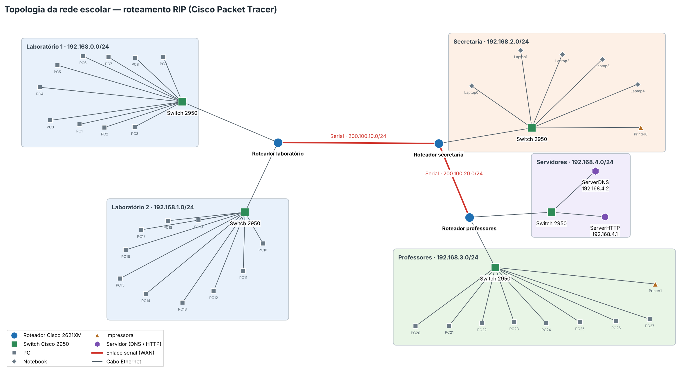

# Rede Escolar com Roteamento RIP

Projeto da disciplina de **Redes de Computadores** do curso de Ciência da Computação da **UNESPAR**, feito no **Cisco Packet Tracer**.

O projeto simula a rede de uma instituição de ensino dividida em cinco sub-redes. Três roteadores Cisco são ligados por enlaces seriais (WAN) e trocam rotas por roteamento dinâmico **RIP**, então qualquer dispositivo alcança qualquer outro.



## Sub-redes

| Setor | Rede | Gateway | Dispositivos |
| --- | --- | --- | --- |
| Laboratório 1 | 192.168.0.0/24 | 192.168.0.100 | 10 PCs |
| Laboratório 2 | 192.168.1.0/24 | 192.168.1.100 | 10 PCs |
| Secretaria | 192.168.2.0/24 | 192.168.2.100 | 5 notebooks, 1 impressora |
| Professores | 192.168.3.0/24 | 192.168.3.100 | 8 PCs, 1 impressora |
| Servidores | 192.168.4.0/24 | 192.168.4.100 | Servidor DNS, servidor HTTP |

## Roteadores e enlaces

| Roteador | Redes locais | Enlaces seriais |
| --- | --- | --- |
| Roteador laboratório | 192.168.0.0/24, 192.168.1.0/24 | 200.100.10.0/24 (secretaria) |
| Roteador secretaria | 192.168.2.0/24 | 200.100.10.0/24 (laboratório), 200.100.20.0/24 (professores) |
| Roteador professores | 192.168.3.0/24, 192.168.4.0/24 | 200.100.20.0/24 (secretaria) |

Cada roteador anuncia as redes ligadas a ele por **RIP**. Um exemplo é o roteador do laboratório:

```
router rip
 network 192.168.0.0
 network 192.168.1.0
 network 200.100.10.0
```

## Serviços

- **Servidor DNS** (192.168.4.2): resolve o nome `kauaneigor` para o servidor HTTP.
- **Servidor HTTP** (192.168.4.1): hospeda uma página web acessível de qualquer sub-rede pelo navegador dos PCs.

## Equipamentos

- 3 roteadores Cisco 2621XM
- 5 switches Cisco Catalyst 2950-24
- 28 PCs, 5 notebooks, 2 impressoras e 2 servidores
- Endereçamento IP estático em todos os hosts

## Conceitos aplicados

Endereçamento IPv4 e divisão em sub-redes, roteamento dinâmico (RIP), enlaces seriais WAN, configuração de roteadores pela CLI do Cisco IOS, DNS e HTTP.

## Como abrir

1. Instale o [Cisco Packet Tracer](https://www.netacad.com/cisco-packet-tracer) (versão 9.0 ou mais recente).
2. Abra o arquivo `rede-escolar.pkt`.
3. Para testar, abra um PC → *Desktop* → *Web Browser* e acesse `kauaneigor`, ou use o `ping` entre sub-redes no *Command Prompt*.
